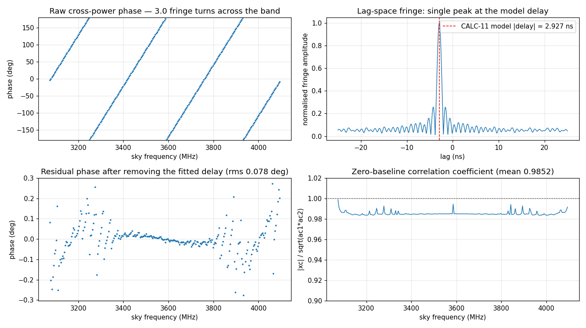
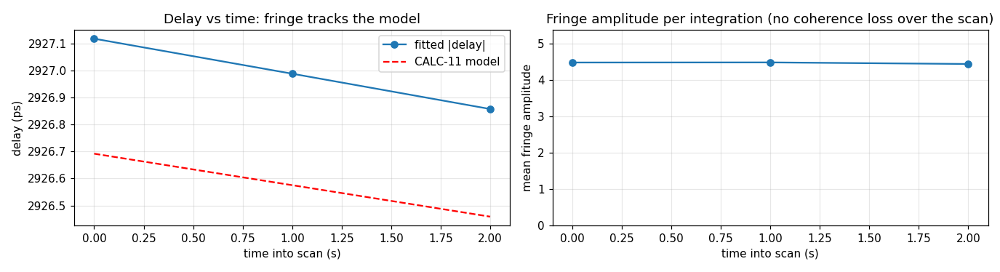

# DiFX zero-baseline test, 1 July 2026

This note records the correlator test behind the sentence in the README that DiFX reads these files
directly. The numbers below come from one hardware recording and one DiFX run, both reproducible with the
scripts in `analysis/`.

## What was recorded

- File `bvex_20260626t200507Z_th0.vdif`, 3 GB, 384,000 frames, 3 s, captured on the recording computer by
  the AF_XDP recorder on 26 June 2026 at 20:05:07 UTC. Noise only, no tone.
- Format string for mark5access: `VDIFC_8000-8192-1-2` (2-bit complex, one channel, 8000-byte payload).

## Decode (mark5access, the decoder inside DiFX)

- `m5time` returns MJD 61217/20:05:07.000, the recording start to the second.
- `m5d` matches a register-exact manual decoder at offset 0 for all 3,000 samples checked, I and Q.
- `m5bstate` over 32 M samples gives level occupancies of 17.1 / 31.0 / 33.5 / 18.4 percent (real) and
  20.7 / 31.0 / 34.7 / 13.7 percent (imaginary), which match the notebook's Van Vleck histograms, including
  the known DC offset on the Q channel.

## Correlation (vex2difx, difxcalc, mpifxcorr; DiFX 2.8.1)

The same file was registered as two stations 1 m apart, so the cross-correlation is of identical data with
a geometric delay that CALC 11 predicts. Three 1 s integrations, 256 channels over the 2 to 4 GHz band.

| Quantity | Value |
|---|---|
| Zero-baseline correlation coefficient, mean across the band | 0.985 |
| CALC-11 model delay at the integration midpoints | 2.9266 ns |
| Delay from the phase-slope fit | 2.9270 ns |
| Delay from the lag-space peak | 2.9297 ns |
| Fit minus model | 0.4 ps (0.014 percent) |
| Residual phase after removing the fitted delay | 0.078 degrees rms |
| Per-integration delay scatter | 0.11 ps rms |

The 1.5 percent loss in the correlation coefficient is the expected 2-bit quantization and processing
loss. Integration timestamps land on the VDIF and PPS second boundaries. The DC spike in channel 0 of the
autocorrelation is the Q-channel DC offset noted above.





## What this test establishes, and what it does not

It establishes that the recorded format, the timestamps and the correlator chain are consistent: DiFX
decodes the file sample for sample and recovers a deliberate, model-predicted delay. It is a consistency
test on one recording, not a fringe between two telescopes. A fringe between two stations, with
independent noise at each, is the goal of the 2027 flight. Still open on the hardware side: the sideband
sense with a CW tone at a known frequency, the Q-channel DC offset, a real station code in the headers,
and recorder runs longer than 20 minutes in the conduction-cooled enclosure now being built.

## Reproduce

```
cd analysis
python3 gen_vex.py && vex2difx bvex.v2d
difxcalc bvex_1.calc
./run_mpifx.sh && python3 parse_difx.py
```

`gen_vex.py` writes the `.vex`, `.v2d` and filelist with `format=VDIF/8032/2` (complex double sideband),
`sample_rate = 2048 Ms/sec` and `minSubarray = 1`. A `bvex_1.threads` file must exist before `mpifxcorr`
runs. `run_mpifx.sh` launches it with `mpirun -np 4 --oversubscribe`.
